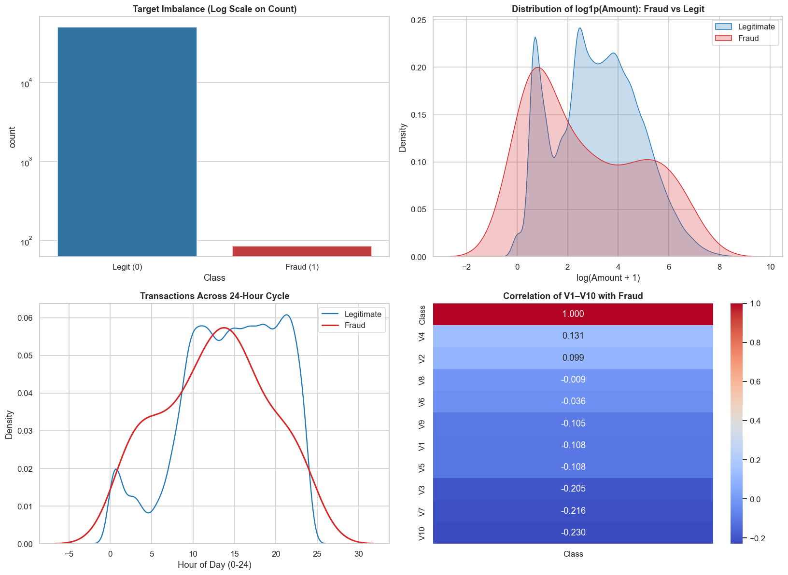
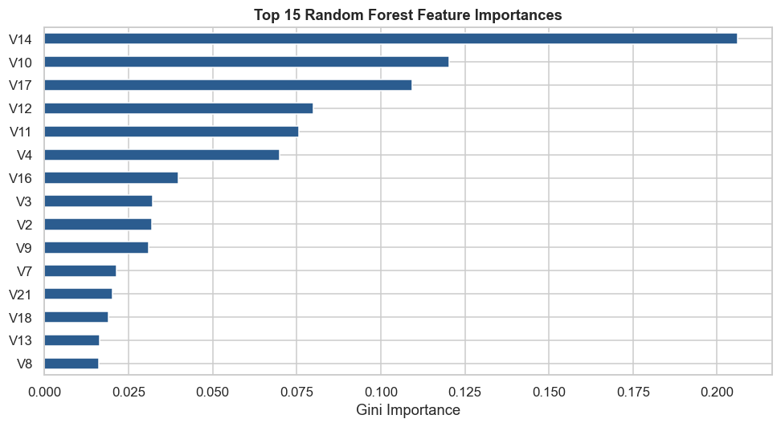
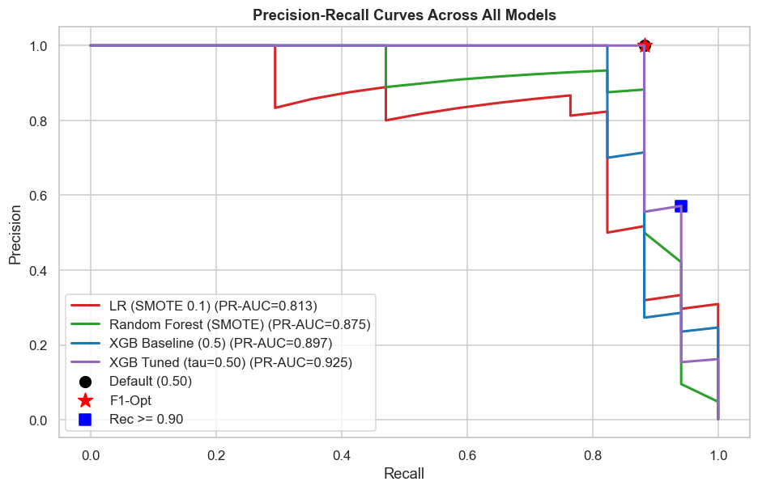

<div align="center">

# 🛡️ Credit Card Fraud Detection
### Supervised Learning • Imbalanced Data • Threshold Optimization

A machine-learning pipeline that identifies potentially fraudulent credit-card transactions, compares classification models, and selects a decision threshold based on business impact.


</div>

[🎥 **Video Explanation**](https://drive.google.com/drive/folders/1_IAReqS78NAOAbQdO0jGSKjQqHTq030E)

---

## 📌 Project Overview

Credit-card fraud detection is a highly imbalanced classification problem: legitimate transactions greatly outnumber fraudulent ones. In this project, the notebook builds and evaluates supervised-learning models while focusing on **Precision, Recall, F1-score, and PR-AUC** rather than accuracy alone.

The workflow includes:

- Exploratory Data Analysis (EDA) of transaction amount, time, and class distribution.
- Stratified sampling of **50,000 transactions** from the original dataset.
- Feature engineering: `Amount_log` and `Hour`.
- Imbalance handling using **SMOTE** and **Random Under-Sampling**.
- Model comparison using Logistic Regression, Random Forest, and XGBoost.
- XGBoost hyperparameter tuning with `RandomizedSearchCV`.
- Threshold optimization using F1-score, high-recall, and business net-benefit criteria.
- Saving and reloading a production-style Scikit-learn pipeline with Joblib.

## 📊 Dataset

**Dataset:** Credit Card Fraud Detection  
**Source:** European cardholders' transactions (September 2013).

- Original dataset: **284,807 rows × 31 columns**
- Legitimate transactions: **99.827%**
- Fraudulent transactions: **0.173%**
- Notebook sample: **50,000 rows**, selected with stratification (`random_state=42`)
- Sample class counts: **49,914 legitimate** and **86 fraud**

🔗 **Dataset download:** [Credit Card Fraud Detection – Kaggle](https://www.kaggle.com/datasets/mlg-ulb/creditcardfraud)

Download `creditcard.csv` from Kaggle and place it in the same folder as the notebook before running it.

### Dataset columns

- `Time`: seconds elapsed between the transaction and the first transaction in the dataset.
- `Amount`: transaction amount.
- `V1`–`V28`: anonymized features obtained through PCA.
- `Class`: target label — `0` = legitimate, `1` = fraud.

## 🖼️ Screenshots & Visual Results

### 1. Exploratory Data Analysis

The plots show class imbalance, transaction amount distribution, transaction activity over a 24-hour cycle, and feature correlation with the fraud class.



### 2. Random Forest – Feature Importance

Top 15 features ranked by the Random Forest model's Gini feature importance.



### 3. Precision–Recall Comparison

Precision–Recall curves compare Logistic Regression (SMOTE), Random Forest, baseline XGBoost, and tuned XGBoost.



## 🤖 Models & Evaluation

The notebook evaluates these approaches:

| Model | Evaluation highlights from notebook |
|---|---|
| Logistic Regression (SMOTE 0.1) | Recall: 1.0000 · F1: 0.4722 · PR-AUC: 0.8133 |
| Random Forest (SMOTE) | Precision: 0.9333 · Recall: 0.8235 · F1: 0.8750 · PR-AUC: 0.8748 |
| XGBoost Baseline | Precision: 1.0000 · Recall: 0.8235 · F1: 0.9032 · PR-AUC: 0.8968 |
| Tuned XGBoost (threshold 0.50) | Precision: 1.0000 · Recall: 0.8824 · F1: 0.9375 · PR-AUC: 0.9255 |

The tuned XGBoost model achieved a cross-validation PR-AUC of **0.7882** during randomized hyperparameter search. The comparison table's test-set PR-AUC for tuned XGBoost is **0.9255**.

## 🎯 Optimal Threshold Used

The notebook calculates three different thresholds for different goals:

| Threshold strategy | Value | Purpose |
|---|---:|---|
| F1-optimal | **0.5622** | Maximizes F1-score on the test-set precision–recall curve |
| High-recall (Recall ≥ 0.90) | **0.0103** | Selects the highest-precision threshold that satisfies the recall target |
| Business-optimal | **0.01** | Maximizes simulated net benefit using the notebook's assumed fraud value and review cost |

### Which threshold is used by the saved model?

**The saved production pipeline uses `0.01` (business-optimal threshold).**

The notebook's business simulation assumes:
- Fraud value / prevented loss: **₹4,500 per detected fraud**
- Manual review cost: **₹150 per flagged transaction**

At threshold `0.01`, the simulation reports:
- True positives: **16**
- False positives: **12**
- False negatives: **1**
- Simulated net benefit: **₹67,800**

> **Important:** The threshold is selected from this notebook's test-set simulation and cost assumptions. It is an educational project result, not a validated threshold for real payment processing. A real deployment should select and validate the threshold on separate validation data and monitor it over time.

## ⚙️ How to Run

### 1. Clone or download this project

Download the project files or clone your repository:

```bash
git clone <your-repository-url>
cd <your-project-folder>
```

### 2. Create and activate a virtual environment (recommended)

```bash
python -m venv .venv
```

**Windows:**
```bash
.venv\Scripts\activate
```

**macOS / Linux:**
```bash
source .venv/bin/activate
```

### 3. Install dependencies

```bash
pip install numpy pandas matplotlib seaborn scikit-learn imbalanced-learn xgboost joblib jupyter
```

### 4. Download the dataset

1. Open the [Kaggle dataset page](https://www.kaggle.com/datasets/mlg-ulb/creditcardfraud).
2. Download and extract the dataset.
3. Put `creditcard.csv` in the project directory, beside `FraudDetection_SupervisedLearning.ipynb`.

Your folder should look similar to this:

```text
Fraud-Detection/
│
├── FraudDetection_SupervisedLearning.ipynb
├── creditcard.csv
├── README.md
└── assets/
    ├── eda_overview.png
    ├── feature_importance.png
    └── precision_recall_curves.png
```

### 5. Start Jupyter Notebook

```bash
jupyter notebook
```

Open `FraudDetection_SupervisedLearning.ipynb` and choose **Kernel → Restart & Run All** (or run each cell from top to bottom).

The notebook performs sampling, preprocessing, model training, hyperparameter tuning, threshold analysis, evaluation, and pipeline serialization. The final cells save:

```text
fraud_detection_model.pkl
```

### 6. Verify the saved pipeline

The final notebook section reloads `fraud_detection_model.pkl`, predicts fraud probabilities for 10 sample transactions, applies the stored business threshold, and displays an `APPROVE` or `BLOCK / REVIEW` action.

## 🧰 Tech Stack

- **Language:** Python
- **Data processing:** NumPy, Pandas
- **Visualization:** Matplotlib, Seaborn
- **Machine learning:** Scikit-learn, Imbalanced-learn, XGBoost
- **Model persistence:** Joblib
- **Environment:** Jupyter Notebook
